<p align="center">
  <a href="https://antonvynohradov.github.io/Baton-C/">
    
  </a>
</p>

<p align="center">
  <a href="https://antonvynohradov.github.io/Baton-C/"><b>Documentation</b></a> ·
  <a href="https://antonvynohradov.github.io/Baton-C/downloads/Baton-C_User_Manual.pdf"><b>PDF user manual</b></a> ·
  <a href="https://github.com/AntonVynohradov/Baton-C/releases"><b>Releases</b></a> ·
  <a href="CHANGELOG.md"><b>Changelog</b></a>
</p>

# Baton-C: Deterministic Master/Slave Messaging over a Single-Wire UART

[](https://github.com/AntonVynohradov/Baton-C/actions/workflows/build-static-lib.yml)
[](https://github.com/AntonVynohradov/Baton-C/actions/workflows/google-unit-tests.yml)
[](https://github.com/AntonVynohradov/Baton-C/actions/workflows/static-analysis.yml)
[](https://github.com/AntonVynohradov/Baton-C/actions/workflows/documentation.yml)
[](https://github.com/AntonVynohradov/Baton-C/actions/workflows/baton-inspector.yml)
[](https://github.com/AntonVynohradov/Baton-C/actions/workflows/zephyr-module.yml)

## Overview

Baton-C is a C11 library for messaging between a few microcontrollers on one shared UART
line (single-wire half duplex, open-drain or RS-485). The master passes a token — the
*baton* — to each slave in turn, so only one node transmits at a time: no collisions and
a worst-case cycle computed from the configuration. On top of this schedule it delivers
**events** exactly once and in order, and **states** whose latest value always arrives.
It does not depend on hardware, an operating system, a clock or a heap, and it is
developed for embedded systems that must comply with **MISRA C:2012**.

### Project Status

✅ **Release 1.0.0** — stable public API and wire format; see [CHANGELOG.md](CHANGELOG.md).

The library, its unit tests (100 % of lines and branches of `src/`), the bus simulation,
the Python twin with the C/Python cross-check, the examples, Baton Inspector and the
documentation are complete. The Cppcheck MISRA C:2012 addon reports no violations; the deviations are
documented in [docs/misra.md](docs/misra.md). **It has not yet been tested on hardware**
— see [Hardware bring-up](docs/integration.md#hardware-bring-up).

---

## About the Baton bus protocol

The protocol is specified in [docs/protocol.md](docs/protocol.md):

```text
SYNC | DST | SRC | CTRL | LEN | PAYLOAD[LEN] | CRC16 (big endian)
0xA5                    TYPE|FIRST|SEQ          CRC-16/CCITT-FALSE over DST..PAYLOAD
```

- **POLL** (master → slave) grants the bus for one slot and carries the master's messages.
- **DATA** / **ACK** (slave → slave) carry messages inside the slot, acknowledged frame by frame.
- **RESP** (slave → master) ends the slot, acknowledges the POLL and reports the nodes
  that did not answer.
- Several messages share one frame (TLV) and one acknowledgement; retransmissions keep
  their sequence number, duplicates are filtered, undeliverable events are reported.

## Objectives

### 🎯 Primary Goals

- **Determinism:** one transmitter at a time, bounded slot and cycle, no function blocks.
- **Embedded-first:** C11, no heap, no RTOS, no global state, no clock reads; 1696 B of RAM
  per node and 280 B of worst-case stack on Cortex-M4 with the default sizes.
- **Reliability:** exactly-once in-order events, latest-value states, CRC-16, retries,
  unreachable nodes isolated, every loss reported.
- **Testing:** GoogleTest with 100 % line and branch coverage enforced, a bus simulation
  with noise and dead nodes on 100 seeds with ASan/UBSan, a Python twin of the codec.
- **MISRA C:2012:** 0 violations, deviation register, Cppcheck and CodeQL in CI.
- **Documentation:** website and PDF manual from the same sources, measured numbers only.

## Roadmap

- [x] Codec, link, event queue, node layer with master and slave state machines
- [x] Unit tests, bus simulation, Python twin, examples, documentation, CI
- [x] Baton Inspector: diagnostic GUI and Python API for automated tests
- [ ] Bring-up on hardware (STM32 single-wire UART, RS-485)
- [x] Zephyr module: devicetree binding, Kconfig, sample, three-node bus test on `native_sim` in CI
- [ ] Run the Zephyr module on a board (Microchip M2S010 MKR Kit)
- [ ] Test on 8/16-bit MCUs (AVR, MSP430): warnings, atomicity of the 32-bit state masks
- [ ] Simulation scenario: a node restarting during operation (FIRST flag)
- [ ] v2: broadcast DATA with slotted acknowledgements; optional periodic state refresh

## Building & Usage

### Prerequisites

- C11 compiler, CMake 3.20+
- Optional: GoogleTest and gcovr (unit tests), Python 3 with pytest (integration tests),
  Cppcheck (MISRA), clang-format, the packages of `requirements-dev.txt` and Doxygen
  (documentation)

### Build with presets

```bash
cmake --preset "BATON[Debug]"            && cmake --build "build/BATON[Debug]"
cmake --preset "BATON[UnitTests]"        && cmake --build "build/BATON[UnitTests]" --target coverage
cmake --preset "BATON[IntegrationTests]" && cmake --build "build/BATON[IntegrationTests]" --target integration_tests
cmake --preset "BATON[Examples]"         && cmake --build "build/BATON[Examples]" && ctest --test-dir "build/BATON[Examples]" -L example
cmake --build "build/BATON[Debug]" --target misra-analyze
tests/run_seeds.sh "build/BATON[UnitTests]" 100      # bus simulation on 100 seeds
```

### Configuration Options

| Option | Default | Description |
| --- | --- | --- |
| `BATON_CONFIG_DIR` | — | Folder with the application's `baton_user_config.h` |
| `BATON_UNIT_TESTS` | `OFF` | GoogleTest, `coverage` target, simulation runner |
| `BATON_INTEGRATION_TESTS` | `OFF` | pytest through CTest |
| `BATON_EXAMPLES` | `OFF` | Host examples |
| `BATON_SANITIZERS` | `OFF` | ASan/UBSan for the simulation runner |
| `BATON_COVERAGE_MIN` | `100` | Coverage gate in percent |
| `BATON_MISRA_FAIL_ON_VIOLATION` | `ON` | `misra-analyze` fails on a violation |

### Using the library in another CMake project

```cmake
set(BATON_CONFIG_DIR ${CMAKE_CURRENT_SOURCE_DIR}/config)   # your baton_user_config.h
include(lib/Baton-C/baton.cmake)
target_link_libraries(app PRIVATE baton)
```

Copy `config/baton_user_config_template.h` as `baton_user_config.h` and define the message
lists — the same on every node of the bus.

### Using the library with Zephyr

Baton-C is a Zephyr module: add it to the west manifest and describe the node in
devicetree; the module owns the UART interrupts and the protocol thread.

```yaml
# west.yml of the application
    - name: baton-c
      url: https://github.com/AntonVynohradov/Baton-C
      revision: v1.1.0
      path: modules/lib/baton-c
```

```dts
&uart1 {
	status = "okay";
	current-speed = <9600>;
	baton0: baton {
		compatible = "systemfromscratch,baton";
		role = "slave";
		address = <0x12>;
		master-address = <0x01>;
		slave-addresses = [11 12];
	};
};
```

See [docs/zephyr.md](docs/zephyr.md) for the API, the options and the `native_sim` bus test.

### Quick Start Example

```c
#include "baton.h"

static const uint8_t slaves[] = {0x11U, 0x12U};
static struct baton_node node;

static int uart_write(void* context, const uint8_t* data, size_t length)
{
    (void) context;
    return board_uart_write(data, length); /* start a non-blocking transmission */
}

void uart_rx_irq_handler(uint8_t byte)
{
    baton_node_rx_isr(&node, byte);
}

int main(void)
{
    struct baton_node_config config;

    baton_node_default_config(&config);
    config.own_address = 0x11U;
    config.master_address = 0x01U;
    config.slave_addresses = slaves;
    config.slave_count = 2U;
    config.write = uart_write;
    (void) baton_node_init(&node, &config, board_millis());
    for (;;)
    {
        baton_node_process(&node, board_millis());
    }
}
```

## Project Structure

```text
Baton-C/
├── baton.h                  umbrella header, version
├── inc/                     baton_config.h, baton_defs.h, baton_protocol.h, baton_link.h,
│                            baton_queue.h, baton_node.h
├── src/                     baton_protocol.c, baton_link.c, baton_queue.c, baton_node.c
├── config/                  baton_user_config_template.h (copy into the application)
├── tests/
│   ├── unit/                GoogleTest
│   ├── sim/                 bus simulation (unit tests and the baton_sim runner)
│   ├── integration/         pytest + Python twin (baton/protocol.py)
│   ├── config/              configuration of the tests and of the analysis
│   └── run_seeds.sh|.ps1    simulation on many seeds
├── examples/                bare_metal, host_serial, shared config
├── zephyr/                  Zephyr module: glue, devicetree binding, sample, native_sim bus test
├── tools/
│   ├── baton_inspector/     Baton Inspector: GUI, Python test API, native bridge, tests
│   └── docs/                diagrams, PDF manual, stack analysis, snippet check
├── docs/                    MkDocs sources (website and PDF manual)
├── overrides/               landing page and header templates
├── cmake/                   version, unit_tests, integration_tests, misra_check
├── .github/                 CI workflows, pull request template, review guidelines
├── .vscode/                 build, test, analysis, tool and documentation tasks
├── .agents/skills/baton-c/  project rules for coding agents (.claude/skills: Claude Code)
├── baton.cmake              library target
└── CMakeLists.txt, CMakePresets.json, mkdocs.yml, requirements-dev.txt
```

## Tools

| Tool | Purpose |
| --- | --- |
| `tools/baton_inspector` | Baton Inspector: diagnostic GUI and Python API for automated tests (master, monitor, simulation; sequence diagram with timing; timing rules; JSON Lines logs) |
| `tools/docs/diagrams.py` | Generates the SVG diagrams of the documentation |
| `tools/docs/build_manual.py` | Builds the PDF user manual |
| `tools/docs/stack_usage.py` | Worst-case stack per function from GCC call graphs |
| `tools/docs/check_snippets.py` | Compiles every C snippet of the documentation |

## Releases & Versioning

Versions follow [Semantic Versioning](https://semver.org/): the public API (`baton.h` and
`inc/`) and the wire format stay compatible within a major version. CMake takes the
version from the `vX.Y.Z` Git tag and passes it as `BATON_VERSION_MAJOR`,
`BATON_VERSION_MINOR`, `BATON_VERSION_PATCH` and the string `BATON_VERSION`; `baton.h`
has the same fallbacks for builds without CMake.

Pushing a `vX.Y.Z` tag runs the [Release workflow](.github/workflows/release.yml): it
checks that the tag matches `baton.h`, `cmake/version.cmake` and `CHANGELOG.md`, runs
every quality gate (unit tests with the coverage gate, integration tests, MISRA,
examples) and publishes the static library with its headers, the MISRA report and the
PDF user manual as a GitHub Release.

## Documentation

- Website: <https://antonvynohradov.github.io/Baton-C/>
- PDF user manual: published with the website and attached to every release

```bash
python -m pip install -r requirements-dev.txt
mkdocs serve                             # live preview
python tools/docs/build_manual.py        # PDF into build/manual/
```

## Author

**Anton Vynohradov** — Embedded Systems Engineer · Founder of SystemFromScratch®

- Website: [systemfromscratch.com](https://systemfromscratch.com)
- GitHub: [github.com/AntonVynohradov](https://github.com/AntonVynohradov)
- LinkedIn: [linkedin.com/in/vynohradov](https://www.linkedin.com/in/vynohradov)
- E-mail: [avynohradov@systemfromscratch.com](mailto:avynohradov@systemfromscratch.com)

## Contributing

Issues and pull requests are welcome. A change must keep 100 % line and branch coverage,
0 MISRA violations (or a recorded deviation), pass the simulation on 100 seeds and
`clang-format`, and update the documentation and `CHANGELOG.md`. See
[Extending the Library](docs/extending.md#contributing-to-the-library).

## License

Copyright © 2026 Anton Vynohradov. Licensed under the [Apache License 2.0](LICENSE).

SystemFromScratch® is a registered trademark. The Apache License 2.0 grants no rights to use
the SystemFromScratch® name or logo; they may not be used to endorse or promote products
derived from Baton-C without prior written permission.

## References

- [Baton bus protocol](docs/protocol.md)
- [MISRA C:2012](https://www.misra.org.uk/)
- [CRC-16/CCITT-FALSE, catalogue of parametrised CRC algorithms](https://reveng.sourceforge.io/crc-catalogue/16.htm)
