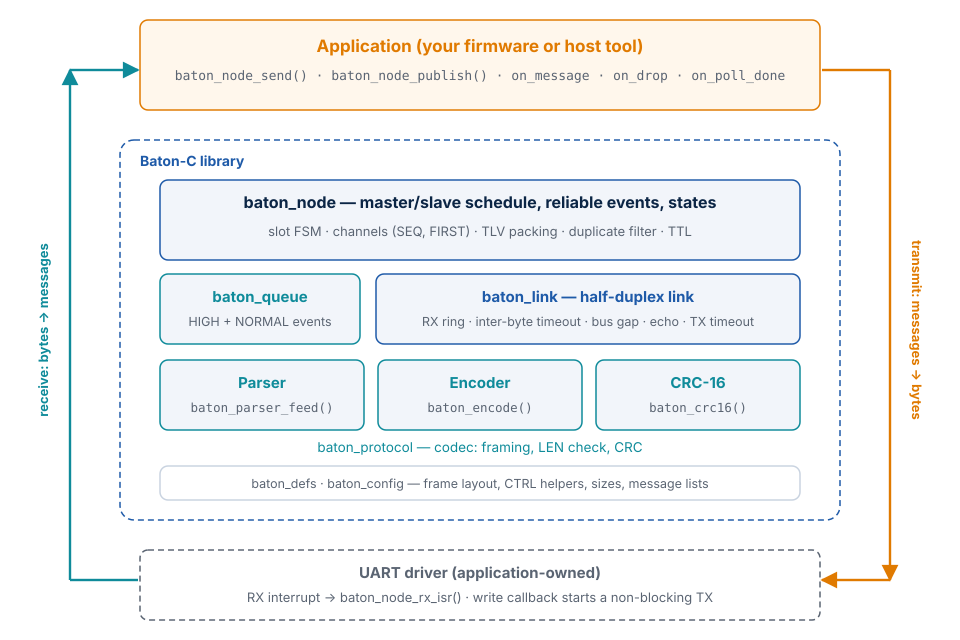
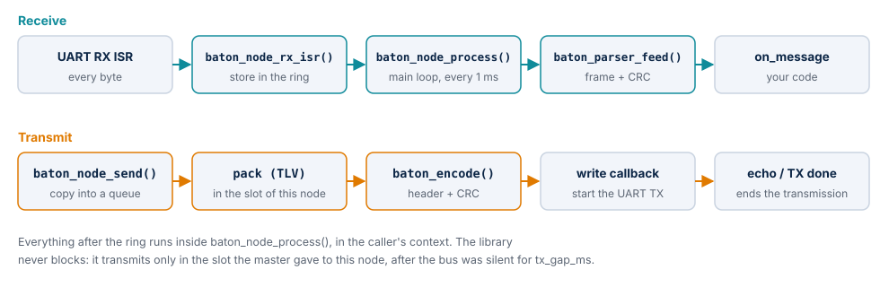
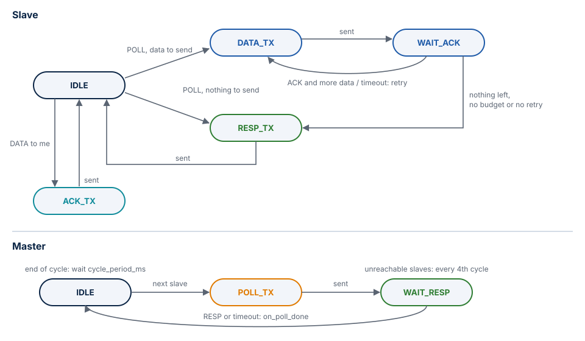

# How It Works

This chapter explains how Baton-C is built: the layers and what each one owns, how
bytes travel through them, how events and states are stored and packed, the state
machines, the memory model, error handling, threading, and the design decisions behind
them.

## Layers

| Layer | Files | Contents |
| --- | --- | --- |
| Configuration | `inc/baton_config.h`, application `baton_user_config.h` | Sizes (each `#ifndef`-guarded and range-checked with `#error`) and the two message lists |
| Definitions | `inc/baton_defs.h` | Frame layout, frame types, ACKB bits, `static inline` CTRL and byte-order helpers. No state |
| Codec | `inc/baton_protocol.h`, `src/baton_protocol.c` | CRC-16, the incremental parser, the encoder. Pure functions over caller buffers |
| Link | `inc/baton_link.h`, `src/baton_link.c` | Receive ring (interrupt producer), parser with inter-byte timeout, transmitter: bus gap, echo check, timeout. Reports events to the node |
| Event queue | `inc/baton_queue.h`, `src/baton_queue.c` | Ring of variable-size records with a serialized 16-byte header |
| Node | `inc/baton_node.h`, `src/baton_node.c` | Master and slave state machines, channels, TLV packing, duplicate filter, TTL, the application API |
| Umbrella | `baton.h` | Includes everything; version fallbacks |

Each layer depends only on the ones below it. The application normally uses only the
eight `baton_node_*` functions; the codec is public so that tools (a bus monitor, a test
generator) can use it alone.

## Data flow

**Receive.** The UART interrupt calls `baton_node_rx_isr()`, which only writes the byte
into the ring of the link (single producer, single consumer, no lock). In
`baton_node_process()` the link drains the ring: bytes of the node's own transmission
are compared with what was sent (echo), every other byte goes to the parser. A complete
valid frame is reported to the node, which dispatches it by type, filters
retransmissions and calls `on_message` once per message.

**Transmit.** `baton_node_send()` copies an event into a queue and returns. When the node
may transmit — a slave in its slot, the master at the start of a slot — it packs
messages for one peer into the payload area of its transmit buffer, `baton_encode()`
adds the header and the CRC in place, and the link calls the write function once the
bus has been silent for `tx_gap_ms`. The transmission ends with the last echo byte
(`rx_echo`) or `baton_node_tx_done_isr()`.

## The parser

The parser is described byte by byte in [Protocol → Parser behavior](protocol.md#parser-behavior).
It decodes into its own `struct baton_frame`, so no second frame buffer exists, and it
computes the CRC while the bytes arrive. The link adds the inter-byte timeout: when more
than `inter_byte_timeout_ms` pass inside a frame, the parser is reset and `rx_timeouts`
counts it.

## The encoder

`baton_encode()` writes SYNC, the header, the payload and the CRC into a caller buffer
after checking the capacity. When the payload already sits at
`&output[BATON_HEADER_SIZE]` — the node packs it there — nothing is copied.

## Event queues

There are two queues, HIGH and NORMAL. Each is a byte array inside `struct baton_node`
holding variable-size records: a 16-byte header — pending mask, inflight mask, time
stamp, id, length, destination, flags, serialized byte by byte (no pointer casts) — and
the data, padded to 4 bytes.

- **Copy in.** `baton_node_send()` copies the data and returns at once; the caller keeps
  no buffer.
- **No split records.** A record that does not fit at the end of the array goes to the
  start; a SKIP marker is left at the end if a header fits there. Data is always
  contiguous.
- **pending** is the node mask still to acknowledge the event; a broadcast sets every
  other node. **inflight** is the node mask with an unacknowledged frame containing it;
  it is always a subset of pending.
- **Release from the head only**, when pending is empty. References held by channels
  therefore stay valid.
- **Peek and commit.** Packing does not remove a record; the acknowledgement does, and a
  retransmission needs no copy.
- **TTL.** Every 10 ms records older than `event_ttl_ms` are removed and reported through
  `on_drop`.

An unreachable destination can hold a record at the head of a queue for at most
`event_ttl_ms`; size the queues for the traffic of that time.

## State mailboxes

Each state has a buffer of its `MAX_LEN`, a current length and a dirty node mask.
`baton_node_publish()` overwrites the value and marks every other node — it never fails
for lack of space. Packing copies the *current* value and clears the destination's bit;
if the frame is not acknowledged, the retransmission carries the latest value again.
Intermediate values may be skipped; the last one always arrives.

## Packing a frame

1. If the channel to the peer has an unacknowledged frame, the same messages are packed
   again with the same SEQ. A state that grew and no longer fits is removed from it and
   sent later.
2. Otherwise the frame is filled with the peer's HIGH events in FIFO order up to the
   first that does not fit, then NORMAL events the same way, then its dirty states.
3. The limits are the remaining slot budget ([Protocol → Time budget](protocol.md#time-budget)),
   the room of the frame type and `BATON_MAX_MSGS_PER_FRAME`.

## State machines

The slave serves its peers in two passes per slot: first the reachable ones in
round-robin order, then the ones with three or more failures in a row, once each and
without retry. A peer that failed in the slot is in the NACK mask and is not served again
in that slot.

The transmitter of the link has three states: idle, waiting for a silent bus, and busy.
Busy ends with the full echo (`rx_echo`) or the TX-done interrupt; a timeout of
`F(length) + tx_gap_ms + 5` ms is the safety net (`tx_timeouts`). An echo mismatch is
counted in `collisions`.

## Memory model

All state lives in one caller-owned `struct baton_node`; the library has no global
variables (only `static const` tables). Its size is fixed at build time by
`baton_user_config.h` — see [Configuration → Memory footprint](configuration.md#memory-footprint).
No function allocates memory, recurses or uses variable-length arrays, so the stack is
fixed: see [Configuration → Stack usage](configuration.md#stack-usage).

## Error handling

| Situation | What happens | Visible as |
| --- | --- | --- |
| Invalid argument | The function returns an error code and changes nothing | `BATON_ERR_*`, `BATON_PARSE_ERROR` |
| Inconsistent configuration | `baton_node_init()` fails; the node stays uninitialized | `BATON_ERR_PARAM` |
| Event queue full | `baton_node_send()` fails; nothing is queued | `BATON_ERR_FULL`, `queue_full` |
| CRC mismatch, LEN too large | Frame dropped | `crc_errors` |
| Gap inside a frame | Frame dropped, parser reset | `rx_timeouts` |
| Receive ring full | Byte dropped | `rx_overflows` |
| Echo differs from the sent bytes | Transmission completes, counted | `collisions` |
| Write fails or no end of transmission | Treated as sent, counted | `tx_timeouts` |
| No ACK | Retry, then NACK in the RESP | `ack_timeouts`, `retries` |
| No RESP | Next slave | `resp_timeouts`, `on_poll_done(responded = false)` |
| Retransmitted content | Acknowledged, not delivered | `duplicates` |
| Unknown or too long message | Skipped | `bad_messages` |
| Event older than `event_ttl_ms` | Removed | `events_dropped`, `on_drop` |

## Threading and reentrancy

| Function | Context |
| --- | --- |
| `baton_node_process()`, `baton_node_init()`, `baton_node_get_stats()` | One context: the main loop or one RTOS task |
| `baton_node_rx_isr()` | UART receive interrupt; writes only the ring |
| `baton_node_tx_done_isr()` | UART TX-complete interrupt; sets a flag |
| `baton_node_send()`, `baton_node_publish()` | Any context **if** `enter_critical`/`exit_critical` are set; otherwise the context of `baton_node_process()` |
| `on_message`, `on_drop`, `on_poll_done` | Always inside `baton_node_process()`; they may call `baton_node_send()` and `baton_node_publish()` |

Critical sections are a few instructions long: reserving queue space, moving head and
tail, copying a state value. Event data is copied outside them. The codec functions are
reentrant on different structures. Several buses need several `struct baton_node`
instances; they do not share anything.

## Design decisions

| Decision | Reason |
| --- | --- |
| POLL as a token (the baton) | Determinism without arbitration: no collisions, a bounded cycle computed from the configuration |
| Two message classes | Events need exactly-once, in-order delivery; states need "latest value wins" and must never overflow |
| Several messages per frame (TLV), one ACK per frame | At 9600 bit/s the 7-byte overhead and the turnaround dominate; packing removes most of it |
| Traffic with the master has no separate ACK | Slave → master content is acknowledged by the ACKB of the next POLL, master → slave content by the ACKB of the RESP in the same slot |
| Stop-and-wait per channel, 4-bit SEQ and FIRST | Simple, exactly-once with one outstanding frame; FIRST survives a restart of the sender |
| Retransmission rebuilt from queue references | No per-frame copy in RAM |
| Only RESP frames with content are acknowledged | An empty RESP shared the SEQ of the next one and confirmed it in advance; the bus simulation found this, the fix is permanent |
| Unreachable nodes served last, polled every 4th cycle | A dead node cannot eat the slot or the cycle of the healthy ones |
| `on_drop` reports the nodes that did not acknowledge | No silent loss: the application knows what may be missing |
| Explicit `now_ms`, no clock reads | Portable, testable with simulated time |
| No broadcast frame with slotted ACKs | It would be more efficient with many receivers but much more complex; kept for a future major version |
