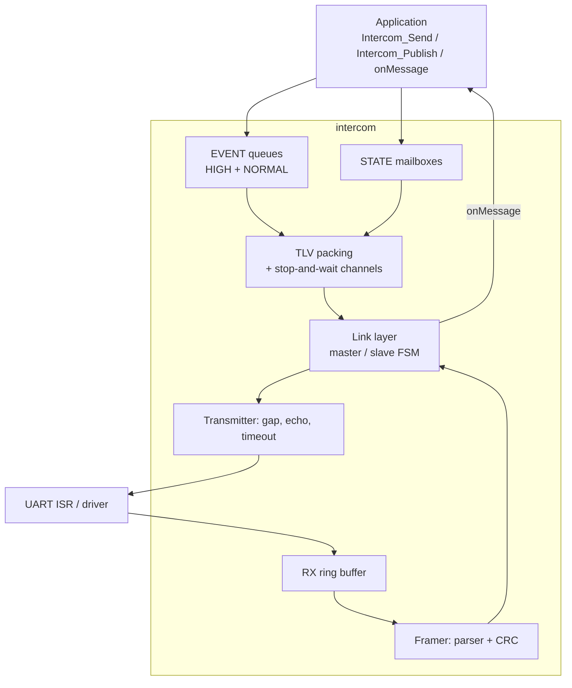
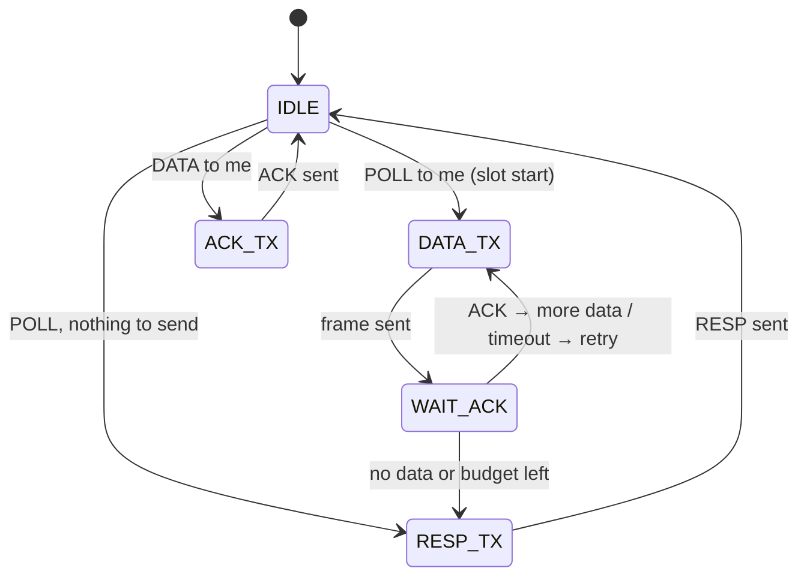
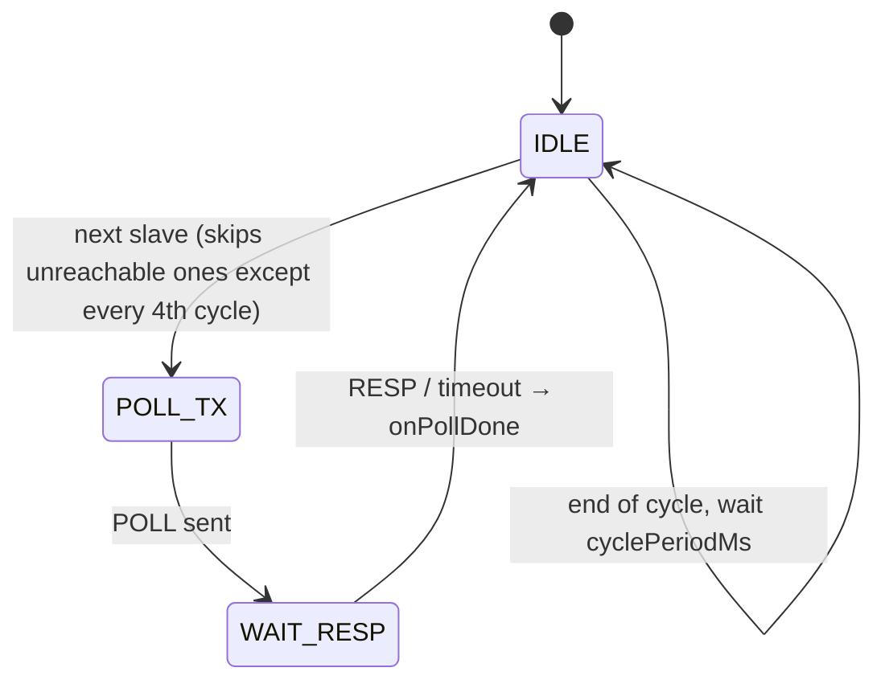

# Architecture

## Layers



| File | Responsibility |
| --- | --- |
| `include/Intercom.h` | Public API, types generated from the message list |
| `src/Intercom.c` | Thin layer over a single static instance |
| `src/ic_core.c` | Parser, transmitter, link layer, packing, deduplication, TTL |
| `src/ic_queue.c` | Ring buffer of variable-length records |
| `src/ic_crc.c` | Table-less CRC-16/CCITT |
| `src/ic_internal.h` | Private structures (`ic_t`), protocol constants, configuration checks |

The internal implementation operates on an `ic_t` instance. This lets the tests run several nodes in one process, and multiple buses could be supported in the future. The public API uses a single static instance.

## Calling context

| Function | Context |
| --- | --- |
| `Intercom_Process` | Main loop or a single RTOS task, every ≤ 1 ms |
| `Intercom_RxByteIsr` | UART RX interrupt; only writes to the ring buffer (SPSC, lock-free) |
| `Intercom_TxDoneIsr` | TX-complete interrupt; sets a flag |
| `Intercom_Send` / `Intercom_Publish` | Any context if `enterCritical`/`exitCritical` are given; otherwise the same as `Process` |
| `on*` callbacks | Always from inside `Intercom_Process` |

Critical sections cover only a few instructions: reserving space in a queue, moving `head`/`tail`, and copying a state value. Event data is copied outside the critical section.

## Event queues (EVENT)

There are two queues: HIGH and NORMAL. Each is a static byte buffer holding variable-length records:

```
+-----------------------------+-------------------+
| ic_rec_t (16 B)             | data[len] (to 4)  |
| pending | inflight | stamp  |                   |
| msgId | len | dst | flags   |                   |
+-----------------------------+-------------------+
```

- **Copy-in.** `Intercom_Send()` copies the data into the queue and returns immediately. The sending module does not have to keep a buffer.
- **No record splitting.** If a record does not fit at the end of the buffer, a SKIP marker is written there and the record goes to the beginning. Record data is always contiguous.
- **`pending`** is the mask of nodes that have not yet acknowledged the record. A broadcast sets the bits of all other nodes.
- **`inflight`** is the mask of nodes to which the record was sent in an unacknowledged frame.
- **Release from the head only.** A record is released when `pending == 0` and `inflight == 0`. This way references held by channels always stay valid.
- **Peek/commit.** Packing does not remove a record from the queue. Only the acknowledgement does, and a retransmission needs no copy.
- **TTL.** Every 10 ms, records older than `eventTtlMs` are removed and reported through `onDrop`.

An unreachable recipient can hold a record at the head of the queue for at most `eventTtlMs`. The queue size should cover the traffic produced during that time.

## State mailboxes (STATE)

Each state has a static `maxLen` buffer, a length and a `dirty` mask:

- `Intercom_Publish()` overwrites the value and sets `dirty` for all other nodes. It never returns "full".
- Packing copies the *current* value and clears the recipient's bit. Intermediate values may be skipped, but the last one always arrives.
- States are delivered with ACK, just like events. If the frame is not acknowledged, the state goes back for retransmission.

## Packing a frame for a recipient

1. If the channel has an unacknowledged frame, the frame is rebuilt from the same message list with the same `SEQ`.
2. Otherwise it is filled in order with:
   - HIGH events for the recipient, in FIFO order, up to the first one that does not fit,
   - NORMAL events on the same basis,
   - changed states.
3. The frame length limit comes from the slot budget ([Protocol](protocol.md#time-budget)) and from `INTERCOM_MAX_MSGS_PER_FRAME`.

## State machines

### Slave



Recipients in a slot are served in two passes. The first covers reachable nodes in round-robin order, the second covers nodes considered unreachable (≥ 3 failures), with a single attempt and no retry.

### Master



### Transmitter

`IDLE → WAIT_GAP → BUSY → IDLE`

- `WAIT_GAP` waits for `txGapMs` of silence and for the end of any frame being received.
- `BUSY` ends when the full echo comes back (`rxEcho = true`) or `Intercom_TxDoneIsr()` is signalled.
- Safety net: a timeout of `F(len) + txGapMs + 5` ms.
- An echo mismatch is counted in `collisions`.

## Memory

All memory is allocated statically in `ic_t`:

```
RAM ≈ INTERCOM_RX_BUF_SIZE
    + INTERCOM_QUEUE_HIGH_SIZE + INTERCOM_QUEUE_NORMAL_SIZE
    + 2 × (7 + INTERCOM_MAX_PAYLOAD) + 7          (TX frame + parser buffer + ACK)
    + INTERCOM_MAX_NODES × (2 × INTERCOM_MAX_MSGS_PER_FRAME + 10)
    + Σ state maxLen + 5 × number of states
    + ~270 B (state variables, counters, configuration)
```

For the configuration template (8 nodes, payload 64, queues 256 + 512, RX 128) this gives **1668 B of RAM** and about **6.6 KB of flash** (Cortex-M3, `-Os`).
