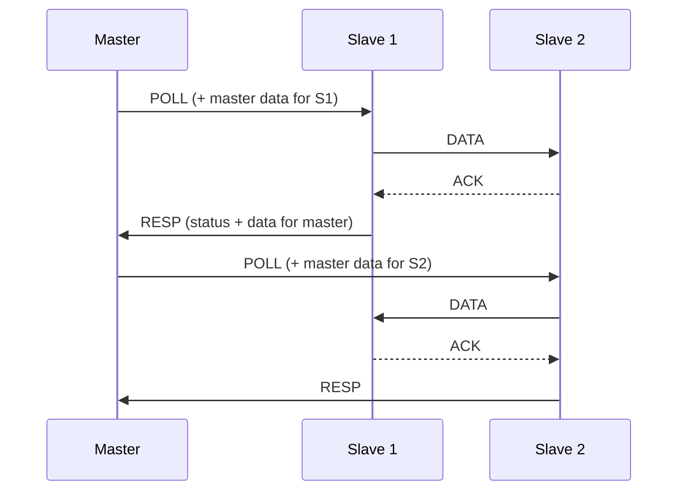

# intercom: documentation

A C99 library for deterministic communication between multiple nodes over a single UART line. One node is the master and sets the pace; the others are slaves and exchange data in the time slots assigned to them.

## Contents

| Document | Contents |
| --- | --- |
| [Getting started](getting-started.md) | Adding the library as a submodule, configuration, minimal master and slave |
| [Protocol](protocol.md) | Frame format, frame types, slot sequence, ACK, sequencing, deduplication, time budget |
| [Architecture](architecture.md) | Layers, event queues, state mailboxes, state machines, handling of unreachable nodes |
| [Configuration](configuration.md) | All `IntercomConfig.h` macros and `IntercomCfg` fields, memory usage |
| [API](api.md) | Every function, error code and callback |
| [Porting](porting.md) | UART integration: STM32 single-wire, RS-485, critical sections, RTOS |
| [Testing](testing.md) | Bus simulator and test scenarios |

## At a glance

- **Determinism.** POLL acts as a token: only the polled slave may transmit, and only for `slotTimeMs`. Other nodes only reply with ACK to frames addressed to them. The worst-case cycle length can be computed in advance, see [Protocol: time budget](protocol.md#time-budget).
- **No blocking.** Every API call returns immediately. All work is done by `Intercom_Process()`, called from the main loop or an RTOS task.
- **Two message classes.** An `EVENT` goes into a queue and is delivered exactly once. A `STATE` is a mailbox where a new value overwrites the old one, so it cannot overflow.
- **Packing.** One frame carries many messages of different lengths (TLV), so a single ACK covers the whole batch.
- **Robustness.** Frames carry CRC-16. Retransmissions are filtered by sequence number. An unreachable node does not block the others, and undelivered events are reported through `onDrop` after `eventTtlMs`.

## Glossary

| Term | Meaning |
| --- | --- |
| Cycle | Polling all slaves one after another |
| Slot | Time from POLL to RESP of one slave; only that slave transmits during it |
| Node | Master or slave; identified by an 8-bit address |
| Node index | 0 = master, i = `slaveAddrs[i-1]`; used in node masks |
| Channel | Stop-and-wait state for a pair of nodes (sequence number, unacknowledged messages) |
| TLV | A single message inside a frame: `id`, `len`, `data[len]` |
