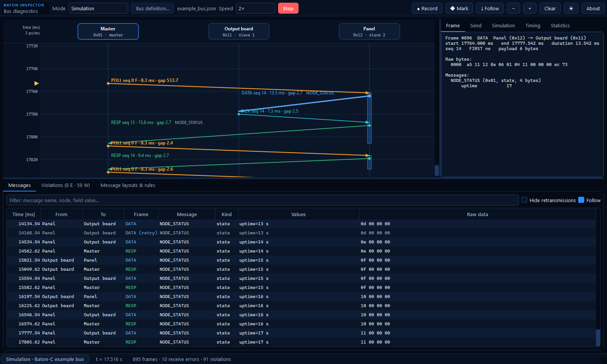
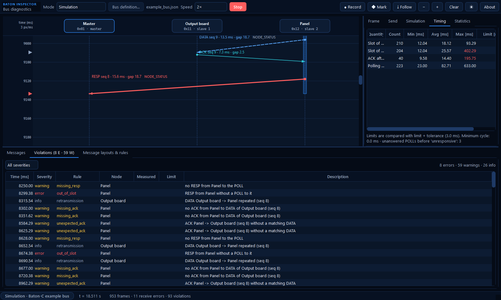
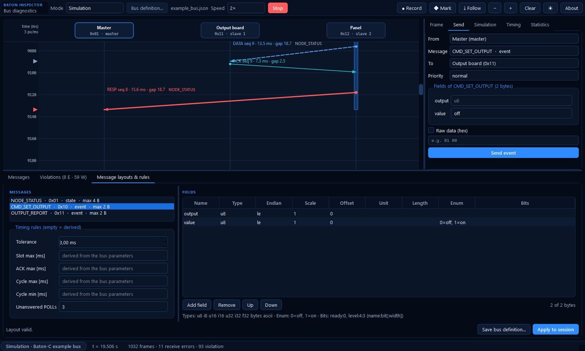
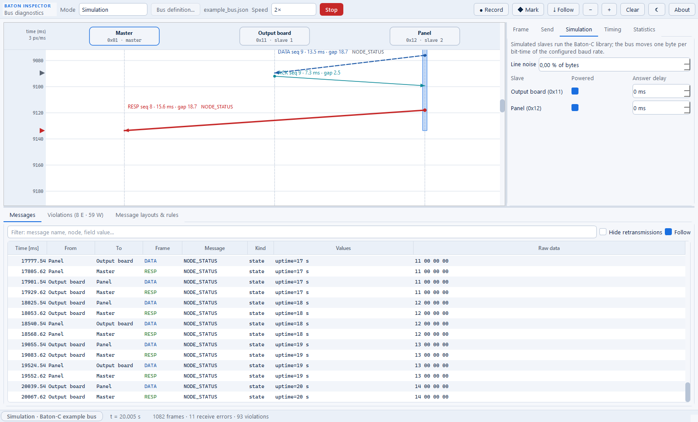

# Baton Inspector

Baton Inspector is the diagnostic tool of Baton-C: a desktop GUI and a Python API for
automated tests. It can be the master of a real bus, listen to it passively, or simulate a
whole bus on the PC; it shows the communication as a live UML sequence diagram with the
timing of every frame, measures slots, response times and cycles, reports timing and
bus-usage violations, decodes message data with configurable field layouts, and records
the parsed session in JSON Lines for analysis after a test run. It lives in
`tools/baton_inspector`.

{ .screenshot }

## Modes

| Mode | What runs | Hardware | Typical use |
| --- | --- | --- | --- |
| Simulation | The master and every slave of the bus definition on a simulated single-wire bus | None | Developing system tests, reproducing faults (noise, unplugged slave, late answers) |
| Master | The PC is the master of the real bus | USB-UART or USB-RS-485 adapter | Testing slaves without the real master; driving a system test |
| Monitor | The PC only listens | USB-UART or USB-RS-485 adapter | Measuring the timing of the real master and slaves |
| Attach | The GUI shows the live feed of a session started by a test | — | Watching an automated test run |

**How it uses the library.** Every node the tool runs — the master and the simulated
slaves — is a `struct baton_node` of the real Baton-C library, and every byte is framed by
`baton_parser_feed()`. The library is compiled into a native bridge
(`tools/baton_inspector/native/inspector_bridge.c`) with the `baton_user_config.h` of the
system under test, so the tool knows the same messages as the firmware. Python only adds
time stamps, decoding of the data fields, the timing analysis and the user interface.

**Timing accuracy.** In the simulation the times are exact (one byte every 10 bit-times).
On a serial port they are the times the PC reads the bytes: USB adapters deliver bytes in
chunks, which limits the accuracy to about 1–2 ms with a 1 ms latency timer (FTDI) and
more with others. That is enough for slots, response times and cycles, not for the
transmit gap (`tx_gap_ms`) or gaps between bytes. Rules are therefore checked with a
tolerance (`tolerance_ms`, default 3 ms).

## Installation

Requirements: Python 3 (tested with 3.12 and 3.14), CMake 3.20+, a C11 compiler (GCC/MinGW-w64, Clang or
MSVC — the bitness of Python), and for the GUI and serial modes the packages of
`tools/baton_inspector/requirements.txt` (PySide6, pyserial). Windows and Linux are
supported; on Linux add the user to the `dialout` group for USB adapters.

```bash
python -m pip install -r tools/baton_inspector/requirements.txt
python tools/baton_inspector/baton_inspector.py --config tools/baton_inspector/examples/example_bus.json --mode simulation --start
```

| Option | Meaning |
| --- | --- |
| `--config FILE` | Bus definition (JSON) |
| `--mode simulation\|master\|monitor` | Mode to select |
| `--port PORT` | Serial port (`COM3`, `/dev/ttyUSB0`) or pyserial URL (`socket://host:port`) |
| `--start` | Start the session at once |
| `--attach PORT` | Show the live feed of a test session on `127.0.0.1:PORT` |
| `--theme dark\|light` | Color theme |

The first session builds the native bridge with CMake into
`tools/baton_inspector/build/<hash>/` (2 s measured on Linux with GCC 13); later sessions with the same
configuration file and library sources reuse it. In VS Code the tasks *Inspector: Run
(Simulation)*, *Inspector: Run* and *Inspector: Tests* do the same.

## The window

| Area | Content |
| --- | --- |
| Toolbar | Mode, bus definition, serial port and echo (master, monitor), speed (simulation), live port (attach), Start/Stop (F5), Record, Mark (Ctrl+M), Follow (End), zoom, Clear, theme |
| Sequence diagram | One lifeline per node. Each frame is an arrow from the sender at its start time to the receiver at its end time, labeled with type, sequence number, duration and the gap since the previous frame, followed by the names of its messages. The slot of the polled slave is an activation bar. Retransmissions are dashed, frames sent by the tool are bold, frames involved in a violation take the color of its severity. Triangles on the time axis mark violations, crosses receive errors, dashed lines test marks. Ctrl + wheel zooms, hovering shows the full frame |
| Frame | Times, sequence, ACKB/NACK, raw bytes and decoded messages of the selected frame, and its violations |
| Send | Send an event or publish a state from the master — in the simulation also from a simulated slave — with a form built from the field layout, or raw bytes |
| Simulation | Line noise, and per slave: powered or not, answer delay |
| Timing | Slots per slave, ACK times and cycles (count, min, avg, max) against their limits |
| Statistics | `baton_stats` of the nodes run by the tool |
| Messages | Every decoded message with time, sender, receiver, frame type, values and raw data; text filter, hide retransmissions |
| Violations | Every rule that was not met; click to jump to the frame |
| Message layouts & rules | The field layouts and timing rules of the bus definition: edit, apply to the running session, save |

{ .screenshot }

{ .screenshot }

{ .screenshot }

The screenshots are taken by `tools/baton_inspector/screenshots.py`, which drives the
real window in simulation mode.

## Bus definition

One JSON file describes the system under test (example:
`tools/baton_inspector/examples/example_bus.json`). Relative paths are relative to the file.

```json
{
  "name": "Baton-C example bus",
  "native": {"user_config": "../../../examples/config/baton_user_config.h"},
  "bus": {
    "baudrate": 9600, "master": "0x01", "slaves": ["0x11", "0x12"],
    "node_names": {"0x01": "Master", "0x11": "Output board", "0x12": "Panel"},
    "slot_time_ms": 250, "ack_timeout_ms": 20, "max_retries": 1, "tx_gap_ms": 2,
    "inter_byte_timeout_ms": 5, "cycle_period_ms": 0, "event_ttl_ms": 5000, "rx_echo": true
  },
  "timing": {"tolerance_ms": 3, "rules": {"slot_max_ms": null, "ack_max_ms": null,
             "cycle_max_ms": null, "cycle_min_ms": null, "unanswered_polls": 3}},
  "messages": {
    "CMD_SET_OUTPUT": {"fields": [
      {"name": "output", "type": "u8"},
      {"name": "value", "type": "u8", "enum": {"0": "off", "1": "on"}}]}
  },
  "simulation": {
    "speed": 1.0, "noise": 0.0, "dead": [], "tx_delay_ms": {},
    "slaves": {"0x11": {
      "auto_reply": [{"on": "CMD_SET_OUTPUT", "send": "OUTPUT_REPORT", "copy": true}],
      "publish": [{"state": "NODE_STATUS", "period_ms": 1000, "fields": {"uptime": "$uptime_s"}}]}}
  }
}
```

| Section | Content |
| --- | --- |
| `native.user_config` | The `baton_user_config.h` of the system: message IDs, lengths and sizes. Required |
| `bus` | Topology and the runtime parameters of `struct baton_node_config`; identical on every node of the real system |
| `timing` | Tolerance and the timing rules; `null` means derived from `bus` (see below) |
| `messages` | Field layouts by message name (names from `baton_user_config.h`; an optional `id` is checked) |
| `simulation` | Speed, noise, unpowered slaves, answer delays, and the behavior of the simulated slaves |

**Field types.** `u8`, `i8`, `u16`, `i16`, `u32`, `i32` with `endian` (`le` default, `be`),
`scale`, `offset` (value = raw × scale + offset) and `unit`; `f32`; `enum` (value → name);
`bits` (named bits or bit ranges of an integer: `{"name": "level", "bit": 4, "width": 3}`);
`bytes` and `ascii` with a `length`. Bytes after the last field are shown as `_rest`; data
shorter than the layout as `_error`. The tool checks that the fields fit the `MAX_LEN` of
the message.

**Simulated slaves.** `auto_reply` sends a message when one arrives: `copy` repeats the
data, `fields` sets values (`"$output"` copies a field of the received message), `data`
gives hex bytes, `to` is `"sender"` (default) or an address. `publish` publishes a state
every `period_ms` (with an optional `offset_ms`); the values `$uptime_s` and `$uptime_ms`
are the simulated time.

## Timing rules

| Rule | Severity | Meaning | Limit (derived default) |
| --- | --- | --- | --- |
| `slot_overrun` | error | End of the POLL → end of the slave's RESP longer than the limit | `slot_max_ms` (`slot_time_ms`) |
| `out_of_slot` | error | A slave sends DATA or a RESP while another one holds the baton | — |
| `overlap` | error | A frame starts before the previous one ended | — |
| `invalid_sender` | error | POLL not from the master, RESP not to the master, DATA with the master | — |
| `cycle_too_long` | error | First POLL of a round → first POLL of the next round | `cycle_max_ms` (slaves × (maximum frame + 2 × `tx_gap_ms` + `slot_time_ms` + 10)) |
| `missing_resp` | warning | A POLL without RESP before the next POLL | — |
| `slave_unresponsive` | warning | `unanswered_polls` POLLs in a row without RESP | 3 |
| `late_ack` | warning | End of a DATA → end of its ACK longer than the limit | `ack_max_ms` (`ack_timeout_ms`) |
| `missing_ack` | warning | A DATA without ACK before the next DATA to the same node or the end of the slot | — |
| `unexpected_resp`, `unexpected_ack` | warning | A RESP or ACK that answers nothing | — |
| `unknown_node` | warning | An address that is not on the bus | — |
| `crc_error`, `frame_timeout` | warning | Bytes rejected by the parser; a frame cut off | — |
| `cycle_too_short` | warning | A cycle shorter than `cycle_min_ms` | `cycle_min_ms` (`cycle_period_ms`) |
| `retransmission` | info | A frame repeated with the same sequence number and content | — |

Every limit is compared with `limit + tolerance_ms`. A number in `timing.rules` overrides
the derived value.

## Python API

The API needs neither Qt nor a display; a test imports it from `tools/baton_inspector`.

```python
from batoninspector import Session

with Session("bus.json", mode="simulation", speed=0, record="run.jsonl") as bus:
    bus.send("Output board", "CMD_SET_OUTPUT", {"output": 2, "value": "on"}, priority="high")
    report = bus.wait_for("OUTPUT_REPORT", src="Output board", timeout_ms=1000)
    assert report.values == {"output": 2, "value": "on"}
    bus.assert_no_violations()
```

| Call | Description |
| --- | --- |
| `Session(config, mode, port=None, rx_echo=None, speed=None, record=None, live_port=None)` | `mode`: `simulation`, `master`, `monitor`. `speed=0` (simulation): time advances only while the test waits — fast and repeatable; `1.0`: real time |
| `start()`, `stop()`, `with Session(...)` | Run the session |
| `send(dst, name, fields=None, data=None, priority="normal")` | Master: queue an event; `dst` is an address, a node name or `"broadcast"` |
| `publish(name, fields=None, data=None)` | Master: publish a state |
| `wait_for(name, src, dst, where, timeout_ms, since_ms)` | Wait for a message seen on the bus; `where` is a dict of field values or a predicate. By default only messages after the last `send`, `publish` or `mark` count. Raises `WaitTimeout` |
| `expect_none(name, src, dst, where, within_ms)` | Fail if a matching message appears |
| `find(...)`, `latest_state(name, src)` | Messages seen so far; the last value of a state |
| `run_for(ms)`, `mark(text)`, `now_ms` | Let time pass; insert a marker; session time |
| `get_violations(min_severity, rule, since_ms, until_ms)`, `assert_no_violations(min_severity="warning", ignore=())` | Timing and bus-usage violations |
| `timing_summary()`, `stats()` | Measured slots, ACK times, cycles and limits; `baton_stats` of the tool's nodes |
| `record(path)`, `stop_recording()` | JSON Lines log |
| `serve_live(port)` | Publish the session for the GUI (*Attach*) on `127.0.0.1` |
| `slave(address).send(...)`, `.publish(...)`, `.received`, `.set_dead()`, `.set_tx_delay(ms)`, `set_noise(p)` | Simulation: script a slave and inject faults |
| `apply_config(BusConfig)` | Use edited field layouts and timing rules |

Records: `MessageRecord` (time, sender, receiver, name, kind, data, `values`, `text`,
`retransmission`), `FrameRecord`, `ErrorRecord`, `Violation` (time, rule, severity, text,
node, measured, limit, frames).

**Example suite.** `tools/baton_inspector/examples/test_example_system.py` runs the same
tests against the simulation (default) or the real bus
(`BATON_MODE=master BATON_PORT=COM3`), writes `test-results/<test>.jsonl` for every test,
and publishes the session for the GUI when `BATON_LIVE_PORT` is set:

```bash
BATON_LIVE_PORT=47555 python -m pytest tools/baton_inspector/examples -v
python tools/baton_inspector/baton_inspector.py --attach 47555
```

## Session log (JSON Lines)

One JSON object per line; times are session milliseconds, `wall` is the UTC time.

| `type` | Content |
| --- | --- |
| `session` | Format version, start time, mode, bus parameters, effective limits, library version, message table, the bus definition |
| `frame` | `t_start_ms`, `t_end_ms`, `wall`, frame type, addresses, `first`, `seq`, prefix (ACKB, NACK), raw bytes, `retransmission`, `own`, and the messages with their decoded `values` |
| `error` | Rejected bytes: `crc` (CRC or LEN) or `timeout` (frame cut off) |
| `violation` | Time, rule, severity, text, node, measured value, limit, frame indexes |
| `mark` | A test marker |
| `stats` | `baton_stats` of the tool's nodes when the recording stopped |
| `end` | Timing summary and the number of violations |

```python
from batoninspector import load_session, messages_of

log = load_session("test-results/test_output_command_is_confirmed.jsonl")
errors = [v for v in log.get("violation", []) if v["severity"] == "error"]
reports = [m for m in messages_of("run.jsonl") if m["name"] == "OUTPUT_REPORT"]
```

## Tests of the tool

`tools/baton_inspector/tests` (field layouts, bus definition, timing rules on synthetic
frames, sessions in simulation, a master on a serial loopback, recording, live feed) and
the example suite run in the *Baton Inspector* CI workflow, together with a GUI start in
offscreen mode.
