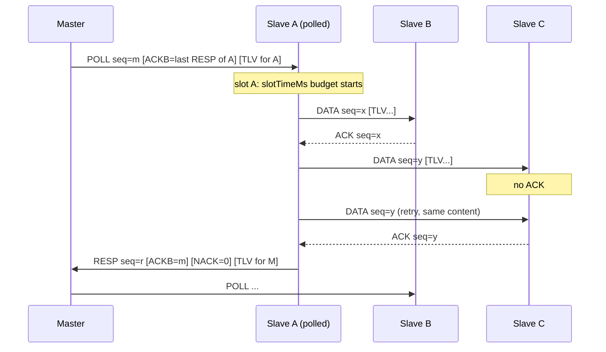

# Protocol

## Physical layer

- UART 8N1, half-duplex, one shared line: single-wire, open-drain or RS-485.
- One byte is 10 bits, so at 9600 bit/s it takes ≈ 1.04 ms.
- Before every transmission a node waits for `txGapMs` of silence on the line (turnaround).
- A frame is aborted when the gap between bytes exceeds `interByteTimeoutMs`.

## Frame format

```
+------+-----+-----+------+-----+-------------+-------+
| SYNC | DST | SRC | CTRL | LEN | PAYLOAD     | CRC16 |
| 0xA5 |  1  |  1  |  1   |  1  | 0..MAX_PAY  |  2 BE |
+------+-----+-----+------+-----+-------------+-------+
```

| Field | Description |
| --- | --- |
| SYNC | `0xA5`, start of frame |
| DST / SRC | Destination / source address. `0xFF` is reserved (broadcast at the API level, never appears in a frame) |
| CTRL | `TYPE[7:6]`, `FIRST[5]`, `reserved[4]`, `SEQ[3:0]` |
| LEN | PAYLOAD length, ≤ `INTERCOM_MAX_PAYLOAD` (≤ 250) |
| CRC16 | CRC-16/CCITT-FALSE (poly `0x1021`, init `0xFFFF`) computed from DST to the end of PAYLOAD, most significant byte first |

Frame overhead is 7 bytes. An ACK (no payload) is 7 B ≈ 7.3 ms.

### Frame types

| TYPE | Name | Direction | PAYLOAD |
| --- | --- | --- | --- |
| 0 | POLL | master → slave | `ACKB` + TLV messages for this slave |
| 1 | RESP | slave → master | `ACKB` + `NACK[mask]` + TLV messages for the master |
| 2 | DATA | slave → slave | TLV messages |
| 3 | ACK | slave → slave | none; `SEQ` = the acknowledged number |

- `ACKB` (1 byte): `bit7` = valid, `bit3..0` = acknowledged sequence number. In POLL it acknowledges the last RESP *with content* from this slave. In RESP it acknowledges the POLL that started the current slot.
- `NACK` (`(INTERCOM_MAX_NODES+7)/8` bytes, little endian): mask of nodes that did not acknowledge DATA in this slot.

### Messages in a frame (TLV)

```
+----+-----+-----------+----+-----+-----------+ ...
| ID | LEN | DATA[LEN] | ID | LEN | DATA[LEN] |
+----+-----+-----------+----+-----+-----------+ ...
```

One frame carries up to `INTERCOM_MAX_MSGS_PER_FRAME` messages of arbitrary lengths. The recipient checks every `ID` and `LEN` against the table from `IntercomConfig.h`. Messages with an unknown identifier or that are too long are skipped and counted in `badMessages`.

## Cycle sequence



1. The master sends a POLL to the next slave in the `slaveAddrs` list. The POLL carries the master's messages for this slave.
2. The polled slave gets the slot. For every other slave that has pending messages it:
   - packs them into a DATA frame without exceeding the remaining budget,
   - waits for an ACK up to `ackTimeoutMs` and retries up to `maxRetries` times if needed,
   - after the ACK, checks whether it has more messages for the same recipient.
3. Finally the slave sends a RESP to the master. The RESP acknowledges the POLL, reports the NACK mask and carries messages for the master.
4. The master moves on to the next slave after the RESP or after a timeout.

Each slot starts with a different recipient (round robin), so no slave is always served last.

## Reliability

### Stop-and-wait per channel

Every pair of nodes (sender → recipient) has an independent channel with a 4-bit `SEQ` number:

- In a given channel the sender has at most one unacknowledged frame with content.
- A retransmission has **the same `SEQ` and the same messages**. The frame is rebuilt from a list of references into the queue, without a separate per-frame buffer.
- `SEQ` advances only after an acknowledgement: an ACK, an `ACKB` in RESP, or an `ACKB` in POLL.
- The recipient remembers the last accepted `SEQ` from each sender. A frame with the same number is acknowledged again but not delivered, and counted in `duplicates`. This gives *exactly-once* semantics.
- Frames **without content** (POLL or RESP without TLV) do not take part in sequencing. The recipient does not deduplicate them, and the master does not acknowledge an empty RESP. This prevents empty frames from acknowledging the next frame with content in advance.

### FIRST flag

After `Intercom_Init()` the sender sets `FIRST` until the first acknowledgement in a given channel. When the recipient sees `FIRST`, it accepts the frame even if the `SEQ` matches, unless the previously accepted frame also had `FIRST` and the same number, which means a retransmission. A sender restart therefore does not cause its first frame to be rejected.

### Abandoning content

When all events from an unacknowledged frame expire (TTL), the channel advances `SEQ`. New content will then not be mistaken for a duplicate.

### Ordering

Events from one sender to one recipient with the same priority arrive in the order they were sent. Packing never skips over a message in the queue. HIGH events may overtake NORMAL ones.

## Unreachable nodes

| Situation | Behaviour |
| --- | --- |
| A slave does not acknowledge DATA | The node's bit goes into the NACK mask in RESP, and the channel's failure counter grows |
| ≥ 3 consecutive failures (`IC_DEAD_STREAK`) | The recipient is served at the end of the slot, without retry: one attempt per slot |
| A slave does not answer a POLL ≥ 3 times | The master polls it only every 4th cycle (`IC_DEAD_POLL_DIV`) |
| An event not delivered within `eventTtlMs` | Removed from the queue; `onDrop(msgId, dst, missedNodes)` |

The first successful acknowledgement resets the failure counter.

`missedNodes` marks the nodes that *did not acknowledge* the message. If only the ACK was lost, the recipient may still have received it. The opposite never happens: every loss is reported.

## Time budget

Notation: `F(n)` is the duration of an `n`-byte frame, i.e. `⌈n·10000/baud⌉` ms; `Fmax = F(7 + INTERCOM_MAX_PAYLOAD)`.

### Slave

Sending another DATA frame is allowed only if there is still time left afterwards for an ACK and a maximum RESP:

```
available_ms = slotTimeMs − elapsed − (Fmax + 2·txGapMs + 2) − txGapMs − ackTimeoutMs
max_payload  = available_ms · baud / 10000 − 7
```

This guarantees that the RESP always ends within `slotTimeMs` of receiving the POLL, regardless of the number of recipients and retries.

### Master

The master waits for a RESP for `slotTimeMs + txGapMs + 10` ms from the end of the POLL. If a frame is being received at that moment, it waits until it ends, but no longer than 2×.

### Minimum slot (checked in `Intercom_Init`)

```
slotTimeMs ≥ Fmax + 3·txGapMs + 2 + ackTimeoutMs + F(7 + 2 + MAX_MSG_LEN)
ackTimeoutMs > F(7) + txGapMs
```

`MAX_MSG_LEN = INTERCOM_MAX_PAYLOAD − 3 − (INTERCOM_MAX_NODES+7)/8`

### Example for the default configuration

9600 bit/s, `INTERCOM_MAX_PAYLOAD = 64`, `txGapMs = 2`, `ackTimeoutMs = 20`, `slotTimeMs = 250`.

| Quantity | Value |
| --- | --- |
| Maximum frame (71 B) | 74 ms |
| ACK (7 B) | 8 ms |
| Minimum slot | 174 ms |
| Empty slot (POLL 8 B + RESP 9 B + gaps) | ≈ 25 ms |
| Worst-case slot, including POLL | ≤ 74 + 2 + 250 + 12 ≈ 340 ms |
| Worst-case cycle, N slaves | ≈ N × 340 ms |

The worst-case cycle depends only on the configuration, not on the traffic. Heavy traffic increases how long messages wait in the queue, but not the slot length.
