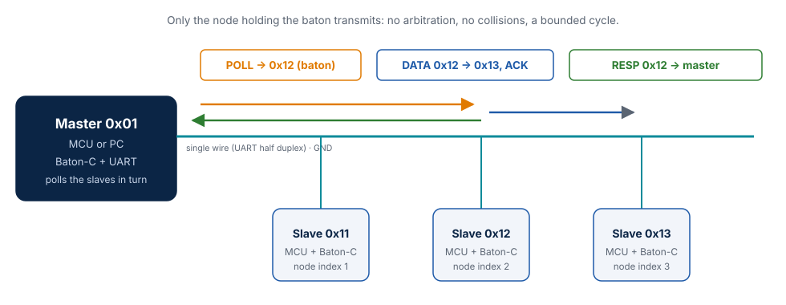
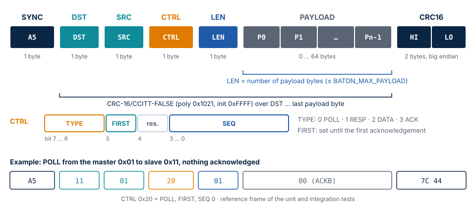
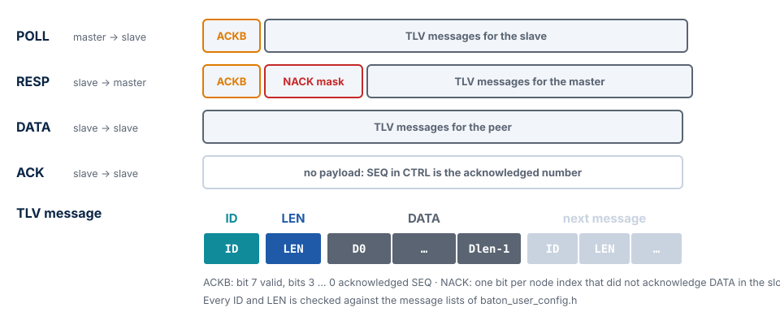
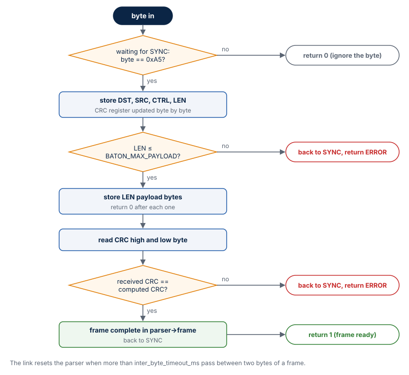

# Baton bus protocol

This chapter specifies the Baton bus protocol — the bytes on the wire, the slot schedule
and the delivery rules — and says exactly what Baton-C does with each part. It is the
specification of the protocol: other implementations (for example the Python twin in
`tests/integration/baton/protocol.py`) are checked against it.

## The bus



| Property | Value |
| --- | --- |
| Medium | One shared UART line: single wire (TX and RX on one pin), open-drain, or RS-485 |
| Character format | 8N1: 10 bits per byte, 1.04 ms per byte at 9600 bit/s |
| Nodes | One master and 1..31 slaves (`BATON_MAX_NODES` 2..32), addresses `0x00`..`0xFE` |
| Topology | Identical on every node: master address and the slave list in polling order |
| Access | Only the polled slave transmits, for at most `slot_time_ms`; other slaves send only ACKs to DATA addressed to them |
| Turnaround | Before transmitting, a node waits for `tx_gap_ms` of silence on the line |

The address `0xFF` (`BATON_ADDR_BROADCAST`) is reserved: it selects "every other node" in
`baton_node_send()` and never appears in a frame.

## Frame



| Offset | Field | Size | Description |
| --- | --- | --- | --- |
| 0 | SYNC | 1 | `0xA5`, start of a frame |
| 1 | DST | 1 | Destination address |
| 2 | SRC | 1 | Source address |
| 3 | CTRL | 1 | `TYPE[7:6]`, `FIRST[5]`, reserved `[4]` (0), `SEQ[3:0]` |
| 4 | LEN | 1 | Number of payload bytes, 0..`BATON_MAX_PAYLOAD` (at most 250) |
| 5 | PAYLOAD | LEN | Depends on the frame type, see below |
| 5 + LEN | CRC16 | 2 | CRC-16/CCITT-FALSE over DST..PAYLOAD, high byte first |

The overhead is 7 bytes. An ACK (no payload) takes 7 bytes, 8 ms at 9600 bit/s; a
maximum frame with the default 64-byte payload takes 71 bytes, 74 ms.

### Checksum

CRC-16/CCITT-FALSE: polynomial `0x1021`, initial value `0xFFFF`, no reflection, no final
XOR. It covers DST, SRC, CTRL, LEN and the payload — not SYNC. The check value of the
catalogue (`"123456789"`) is `0x29B1`; it is a unit test. Baton-C computes it bit by bit
without a table (no 512-byte table in flash; at 9600 bit/s the cost does not matter).

### Frame types and payloads



| TYPE | Name | Direction | Payload |
| --- | --- | --- | --- |
| 0 | POLL | master → slave | `ACKB`, then messages for this slave |
| 1 | RESP | slave → master | `ACKB`, `NACK` mask, then messages for the master |
| 2 | DATA | slave → slave | Messages for the destination |
| 3 | ACK | slave → slave | None; `SEQ` in CTRL is the acknowledged sequence number |

- **ACKB** (1 byte): bit 7 = valid, bits 3..0 = acknowledged sequence number. In a POLL it
  acknowledges the last RESP *with content* from this slave; in a RESP it acknowledges
  the POLL that started the slot.
- **NACK** (`(BATON_MAX_NODES + 7) / 8` bytes, little endian): the node mask of the slaves
  that did not acknowledge a DATA frame of this slave in this slot.

### Messages (TLV)

A payload carries messages back to back, each as `ID`, `LEN`, `DATA[LEN]`. One frame
carries up to `BATON_MAX_MSGS_PER_FRAME` messages. The receiver checks every `ID` and
`LEN` against the message lists of `baton_user_config.h`; an unknown id or a length
above the `MAX_LEN` of the message is skipped and counted in `bad_messages`, a truncated
record ends the payload. The largest `MAX_LEN` is
`BATON_MAX_MSG_LEN = BATON_MAX_PAYLOAD − 3 − BATON_MASK_BYTES`, so that one message fits
into every frame type.

## Parser behavior



`baton_parser_feed()` takes one byte per call:

1. Between frames it waits for `0xA5`; other bytes are ignored.
2. It stores DST, SRC, CTRL and LEN, updating the CRC register with each byte.
3. A LEN above `BATON_MAX_PAYLOAD` is rejected as soon as it is read: return
   `BATON_PARSE_ERROR`, wait for SYNC.
4. It stores LEN payload bytes, then the two CRC bytes.
5. A matching CRC returns `1` (the frame is in `parser->frame`); a mismatch returns
   `BATON_PARSE_ERROR`. Either way the parser waits for the next SYNC.

Recovery: the bytes of a rejected frame are not scanned again for a SYNC byte. The link
resets the parser when more than `inter_byte_timeout_ms` pass between two bytes of a
frame, so a frame cut off by noise costs at most that timeout. A corrupted parser
structure (state or index out of range) is detected and reset instead of writing out of
bounds; this is a unit test.

## The slot


1. The master sends a POLL to the next slave in `slave_addresses`, carrying the master's
   messages for it.
2. The polled slave owns the slot. For every other slave with pending messages it:
    - packs them into a DATA frame that fits the remaining time budget,
    - waits up to `ack_timeout_ms` for the ACK and retries up to `max_retries` times,
    - after an ACK, serves the same peer again if it has more.
3. Finally the slave sends a RESP: it acknowledges the POLL, reports the NACK mask and
   carries messages for the master.
4. The master moves on after the RESP or after a timeout.

Each slot starts with a different peer (round robin), so no slave is always served last.

## Delivery rules

### Stop-and-wait per channel

Every ordered pair of nodes has an independent channel with a 4-bit sequence number:

- A sender has at most one unacknowledged frame with content per channel.
- A retransmission has **the same SEQ and the same messages**. It is rebuilt from
  references into the queue, so no copy of the frame is kept.
- SEQ advances only after an acknowledgement: an ACK, the ACKB of a RESP, or the ACKB
  of a POLL.
- The receiver remembers the last accepted SEQ of each sender. A frame with the same
  number is acknowledged again but not delivered, and counted in `duplicates`. Events
  are therefore delivered exactly once.
- Frames **without content** (POLL or RESP without messages) do not take part in
  sequencing: the receiver does not filter them, and the master does not acknowledge an
  empty RESP. An empty frame therefore never acknowledges the next frame with content in
  advance.

### FIRST flag

After `baton_node_init()` a sender sets FIRST in each channel until its first
acknowledgement. A receiver accepts a FIRST frame even when its SEQ equals the last
accepted one, unless that one was also a FIRST frame with the same SEQ (a
retransmission). A sender that restarts is therefore not mistaken for a duplicate.

### Order

Events from one sender to one destination with the same priority arrive in the order
they were sent: packing never skips a message of a queue. HIGH events may overtake
NORMAL ones.

### Abandoned content

When every event of an unacknowledged frame expired (TTL), the channel advances SEQ, so
new content is not mistaken for a duplicate.

## Unreachable nodes

| Situation | Behavior |
| --- | --- |
| A slave does not acknowledge DATA | Its bit goes into the NACK mask of the RESP; the failure streak of the channel grows |
| 3 failures in a row (`BATON_DEAD_STREAK`) | The peer is served last in the slot, once, without retry |
| A slave does not answer 3 POLLs in a row | The master polls it only every 4th cycle (`BATON_DEAD_POLL_DIV`) |
| An event is not delivered within `event_ttl_ms` | Removed; `on_drop(msg_id, dst, missed_nodes)` |

The first acknowledgement resets the failure streak. `missed_nodes` lists the nodes that
did *not acknowledge* the event: a node may still have received it when only its ACK was
lost. The reverse never happens — every loss is reported.

## Time budget

`F(n)` is the duration of an `n`-byte frame, `⌈n · 10000 / baudrate⌉` ms;
`Fmax = F(7 + BATON_MAX_PAYLOAD)`.

**Slave.** A DATA frame is started only if an ACK and a maximum RESP still fit:

```text
available_ms = slot_time_ms − elapsed − (Fmax + 2·tx_gap_ms + 2) − tx_gap_ms − ack_timeout_ms
max_payload  = min(available_ms · baudrate / 10000 − 7, BATON_MAX_PAYLOAD)
```

The RESP therefore always ends within `slot_time_ms` after the POLL, whatever the number
of peers and retries.

**Master.** It waits for the RESP `slot_time_ms + tx_gap_ms + 10` ms after the end of the
POLL. If a frame is being received at that moment it waits for its end, but at most
twice as long.

**Checked by `baton_node_init()`:**

```text
slot_time_ms   ≥ Fmax + 3·tx_gap_ms + 2 + ack_timeout_ms + F(7 + 2 + BATON_MAX_MSG_LEN)
ack_timeout_ms > F(7) + tx_gap_ms
```

For the defaults (9600 bit/s, 64-byte payload, gap 2 ms, ACK timeout 20 ms, slot 250 ms):

| Quantity | Value |
| --- | --- |
| Maximum frame (71 bytes) | 74 ms |
| ACK (7 bytes) | 8 ms |
| Minimum slot | 174 ms |
| Empty slot (POLL 8 bytes + RESP 9 bytes + gaps) | about 25 ms |
| Longest slot, POLL included | at most 74 + 2 + 250 + 12 ≈ 340 ms |
| Longest cycle with N slaves | about N × 340 ms |

The longest cycle depends only on the configuration. Heavy traffic makes messages wait
longer in the queues; it does not make a slot longer.

## Reference frames

Computed independently by the Python twin and used as unit and integration test vectors:

| Frame | Bytes |
| --- | --- |
| POLL 0x01 → 0x11, FIRST, SEQ 0, ACKB not valid | `A5 11 01 20 01 00 7C 44` |
| ACK 0x11 → 0x12, SEQ 3 | `A5 12 11 C3 00 45 5B` |
| RESP 0x11 → 0x01, FIRST, SEQ 0, ACKB valid SEQ 0, NACK 0 | `A5 01 11 60 02 80 00 C9 91` |
| DATA 0x11 → 0x12, FIRST, SEQ 0, message 0x10 = `AB CD` | `A5 12 11 A0 04 10 02 AB CD D8 BA` |
